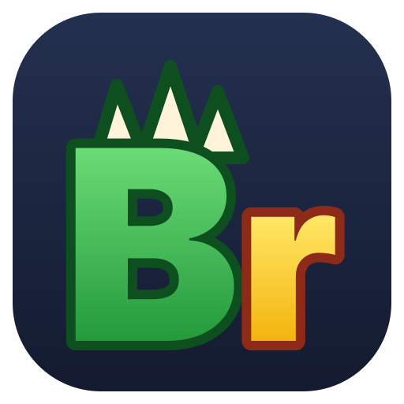

<p align="center"></p>

<h1 align="center">BrOWSER</h1>

<p align="center">Chrome, Edge and Brave extension that fills in forms on the open page from a natural-language request, using <b>the AI subscription you already pay for</b> (Google AI Pro, ChatGPT or Claude) — no API key.</p>

<p align="center"><a href="https://saironbusatto.github.io/BrOWSER/">saironbusatto.github.io/BrOWSER</a></p>

---

## How it works

```
Side panel (extension) ──► Local bridge ──► Official AI tool (agy / codex / claude)
                                ▲                          │
                                └──── MCP tools ◄──────────┘
                                      (read fields, fill, click)
```

- The **extension** reads and fills the page (via `chrome.debugger`, with a DOM fallback plan).
- The **bridge** is a small program installed on your computer that connects the extension to the official AI tool, logged in with your subscription. An extension alone cannot run programs — that is why the bridge exists.
- The AI **never submits the form**: it fills and stops; you are the one who clicks Submit. This is not just
  a prompt instruction — the bridge **refuses, in code**, the click on the final submit button and hands the
  decision back to you.
- The panel has a **Stop button**: it drops the AI instantly, without waiting. Your sovereignty, not the machine's.

## Install

One package per platform, with the bridge **and** the extension inside. No step requires
`root`, administrator, Node, Bun or `npm install`.

**Before installing**, the binary tells you whether the machine has what BrOWSER needs. It checks the
browser, the bridge registration and the AI tools installed and logged in, exits with code 1
while something is missing, and tells you what to do.

```bash
./bridge --doctor                                        # Linux
"%LOCALAPPDATA%\BrOWSER\bridge.exe" --doctor              # Windows
```

### Windows

1. Download `BrOWSER-windows.zip` from [Releases](https://github.com/saironbusatto/BrOWSER/releases) and **extract it** (do not click inside the zip: Windows would copy only the clicked file, and the installer would not find the rest).
2. **Double-click `instalar.cmd`.** The installer shows what it will change on your computer and where your data goes, and asks before doing it. No administrator, Node, Bun, Python or npm needed.
3. If the Antigravity CLI (`agy`) is not installed, it shows the URL of the official Google installer and asks whether you want to install it. **It downloads nothing on its own.**
4. **Restart the browser** and load the extension from inside the extracted folder: `chrome://extensions` → Developer mode → Load unpacked → the `extensao` folder next to `instalar.cmd`.
5. Check with `"%LOCALAPPDATA%\BrOWSER\bridge.exe" --doctor`.

If you prefer the terminal, or if the `.cmd` window does not open (company policy or antivirus may block `.cmd`), the installer is `setup.ps1` and runs directly:

```powershell
powershell -NoProfile -ExecutionPolicy Bypass -File .\setup.ps1
```

Why a `.cmd` and not a bare `.ps1`: double-clicking a `.ps1` sometimes opens Notepad instead of running it, and the default `ExecutionPolicy` refuses scripts downloaded from the internet. The `.cmd` solves both, keeps the window open so the result can be read, and is what people click.

### Linux

1. Download `BrOWSER-linux.tar.gz` from [Releases](https://github.com/saironbusatto/BrOWSER/releases) and extract it.
2. Run `./install.sh`. No `root`: the bridge goes to `~/.local/share/BrOWSER` and the registration to `~/.config`.
3. **Restart the browser** and install the extension from inside the package at `~/.local/share/BrOWSER/extensao`: `chrome://extensions` → Developer mode → Load unpacked.
4. Check with `~/.local/share/BrOWSER/bridge --doctor`.

**Loading the extension is always manual, and that is Chrome's decision**, not a limitation of ours: a
regular browser does not let any program install an extension without your confirmation. Only in a
managed environment (company, school, kiosk) can the extension be distributed already installed.

And do not double-click `install.sh`: on Linux that **opens the code in a text editor**.
It is meant for the terminal — `./install.sh`, or right-click → "Run in Terminal".

### macOS

There is no published macOS binary yet. The code works, but the release ships no
executable: until then, the path is to build the bridge from source.

### The AI tool

BrOWSER uses **your subscription**, never an API key: `agy` (Google AI Pro),
`codex` (ChatGPT) or `claude` (Claude Pro/Max), according to the plan you connect in the
panel. Each one has its own official installer and **BrOWSER installs none of them** —
choosing which one to use is up to you. `--doctor` tells you what is missing. Python 3 is only needed for
the Google AI Pro login, which requires an interactive terminal.

## Uninstall

- **Windows:** Settings → Installed apps → BrOWSER → Uninstall (or the "Uninstall BrOWSER" shortcut in the Start Menu). It removes the bridge, the browser registrations and the local data.
- **Linux:** `~/.local/share/BrOWSER/install.sh --desinstalar` (or `bridge --uninstall` to remove only the registration and local data).
- **Then remove the extension from the browser** — in neither case is that automatable.

## Privacy

- BrOWSER **sends no data to the project authors**. There is no server of ours.
- Page content goes to the AI that **you** connected (Google, OpenAI or Anthropic) **only when you make a request** in the panel. Password fields are never read: the extension knows the field exists (so it can fill it) but does not read what is inside.
- The bridge downloads a public index of site maps from GitHub and, if one exists, the map of the open site — without sending your data.
- "Form learning" is **off by default** and stores **only the structure** of pages
  (labels and buttons, no values, with personal data masked), on your computer. Even when enabled, it
  **never** learns login or payment pages, and password fields never enter the map. Enable it in
  Subscriptions → Form learning.
- Full policy: [docs/termos-e-privacidade.md](docs/termos-e-privacidade.md).

## Development

```bash
bun install
bun run verificar          # lint + typecheck + tests
bun run test:coverage      # coverage report
bun run lint:fix           # fixes what it can
bun run --cwd packages/extension build          # extension in packages/extension/.output/chrome-mv3
bun run --cwd packages/bridge build:dev         # development bridge (keeps the spike's /control)
bun run --cwd packages/bridge build             # release bridge (/control unreachable)
bun run --cwd packages/bridge install-host      # registers the bridge (Linux/macOS, from source)
bun run spike <agy|codex|claude>                # end-to-end test on the sample form
```

Project decisions: [docs/decisoes.md](docs/decisoes.md).

## Code signing policy

> Status: **application to the SignPath Foundation in preparation** — current binaries are not yet signed.

Free code signing provided by [SignPath.io](https://about.signpath.io), certificate by [SignPath Foundation](https://signpath.org) (once approved). Only artifacts built by this repository's GitHub Actions workflows from this repository's source code are signed.

- Committers and reviewers: [saironbusatto](https://github.com/saironbusatto)
- Approvers: [saironbusatto](https://github.com/saironbusatto)
- All team members use multi-factor authentication on GitHub and SignPath.

**Privacy policy.** This program will not transfer any information to other networked systems unless specifically requested by the user or the person installing or operating it. Page content is sent only to the AI provider the user connected (Google, OpenAI or Anthropic), and only when the user submits a request in the side panel. The bridge downloads a public index of site maps from this GitHub repository without sending user data.

## License

[Apache-2.0](LICENSE)
